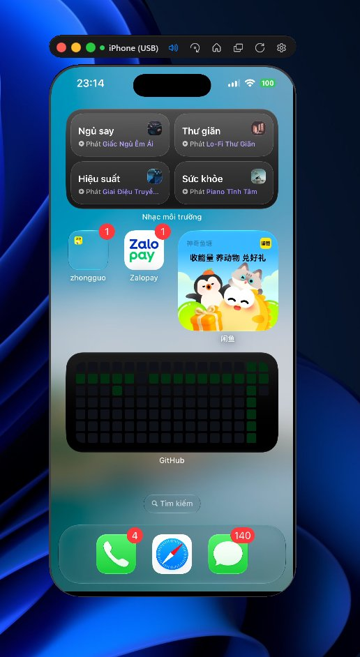
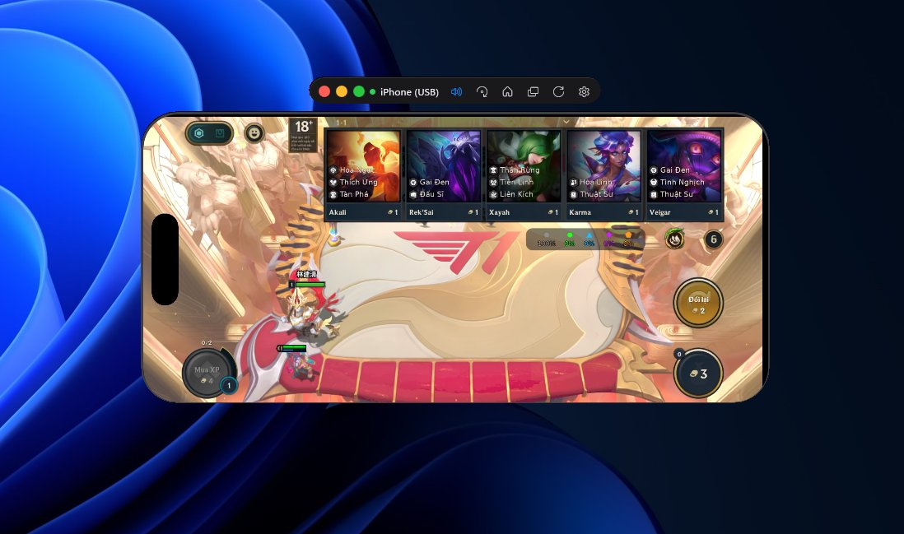
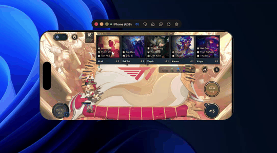
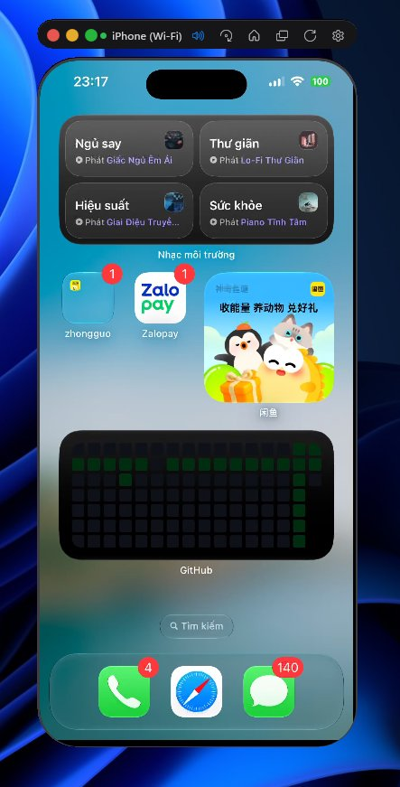
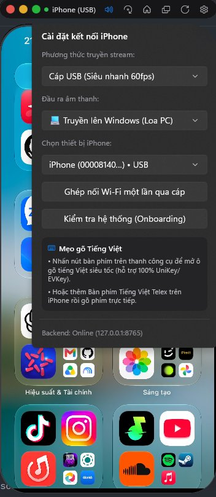
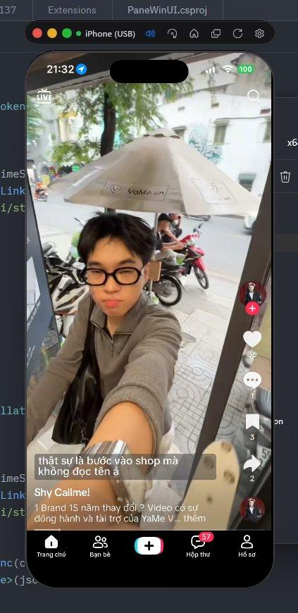
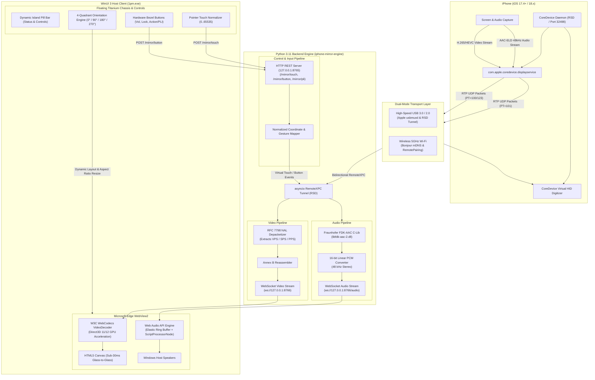

# 1pm — Native iPhone Mirroring for Windows

<div align="center">

[-0078D6?logo=windows)](https://microsoft.com/windows)
[](https://apple.com/ios)
[](https://dotnet.microsoft.com/)
[](https://dotnet.microsoft.com/)
[](https://python.org/)
[](#video-pipeline)
[](#audio-pipeline)

**A high-performance, ultra-low latency iPhone screen and audio mirroring client for Windows.**  
Brings the seamless **macOS Sequoia "iPhone Mirroring"** experience to Windows 10/11 using native WinUI 3, hardware-accelerated WebCodecs H.265 decoding, Fraunhofer FDK-AAC audio forwarding, and direct Apple CoreDevice RemoteXPC communication over USB and Wi-Fi.

[Features](#key-features) • [Showcase](#visual-showcase) • [Architecture](#technical-architecture) • [Requirements](#system-requirements) • [Build Guide](#compilation--build-guide) • [Troubleshooting](#troubleshooting)

</div>

---

## Visual Showcase

### 1. High-Performance Portrait Mirroring (USB Transport)
<div align="center">
  
  <p><em><b>Figure 1:</b> 1pm mirroring an iPhone running iOS in native Portrait mode over high-speed USB (60 FPS). Displays floating titanium frame, macOS Sequoia-style top pill control bar, Dynamic Island status indicator, and real-time audio forwarding active badge.</em></p>
</div>

---

### 2. Full-Screen 90° Landscape Gaming (Teamfight Tactics)
<div align="center">
  
  <p><em><b>Figure 2:</b> 1pm operating in Landscape 90° orientation running Teamfight Tactics (TFT) mobile. The window dynamically calculates the exact viewport aspect ratio, maintaining pixel-perfect Direct3D hardware-accelerated HEVC rendering without distortion or black letterboxing.</em></p>
</div>

---

### 3. Real-Time Gameplay Demo (60 FPS H.265 & Synchronized Audio)

<div align="center">
  
  <br/><br/>

  <video src="https://raw.githubusercontent.com/williamcachamwri/1pm/main/docs/assets/demo_gameplay_60fps.mp4" controls width="750" poster="docs/assets/demo_landscape_game.jpg">
    <source src="https://raw.githubusercontent.com/williamcachamwri/1pm/main/docs/assets/demo_gameplay_60fps.mp4" type="video/mp4" />
  </video>

  <p>
    📁 <b>Direct Media File:</b> <a href="https://raw.githubusercontent.com/williamcachamwri/1pm/main/docs/assets/demo_gameplay_60fps.mp4">demo_gameplay_60fps.mp4</a> (48 kHz AAC Audio)
  </p>
  <p><em><b>Video 1:</b> Live capture demonstrating sub-30ms touch-to-display latency during TFT gameplay. The user drags and drops game units in real-time with responsive mouse-to-touch mapping while synchronized 48 kHz stereo audio is decoded via Fraunhofer FDK-AAC and routed to the Windows host soundcard.</em></p>
</div>

---

### 4. Wireless Mirroring over Wi-Fi (Apple Bonjour / RemotePairing)
<div align="center">
  
  <p><em><b>Figure 3:</b> Cable-free screen mirroring over local 5GHz Wi-Fi via Apple RemotePairing and Bonjour mDNS discovery. The pill bar status dynamically updates to <code>iPhone (Wi-Fi)</code> with automatic channel bandwidth adaptation.</em></p>
</div>

---

### 5. Settings, Diagnostics & Audio Output Routing
<div align="center">
  
  <p><em><b>Figure 4:</b> Settings Flyout panel providing instant switching between USB (60fps) and Wi-Fi transports, output audio target selection (Windows PC speakers vs. iPhone native speaker), device pairing controls, and system onboarding verification.</em></p>
</div>

---

### 6. Media Playback & Audio Forwarding (TikTok / Social Feeds)
<div align="center">
  
  <p><em><b>Figure 5:</b> Streaming high-framerate short-form video (TikTok). The phone's native speakers are automatically muted while high-definition stereo audio is forwarded in real time through the Fraunhofer FDK-AAC pipeline into the Windows PC speakers.</em></p>
</div>

---

## Key Features

- **macOS Sequoia Floating iPhone Chassis**:
  - Precision WinUI 3 interface with dark titanium border, rounded OLED display corners, and iOS Dynamic Island emulation.
  - Floating top pill bar displaying real-time transport mode (`USB` / `Wi-Fi`), audio forwarding indicator, orientation toggle, home button, app switcher, reload, and settings.
  - Physical side buttons (Volume Up, Volume Down, Power/Lock, and Action Button for instant H.265 Keyframe PLI refresh).

- **Ultra-Low Latency 60 FPS HEVC / H.265 Video Pipeline**:
  - Directly taps into Apple's internal `com.apple.coredevice.displayservice`.
  - Zero-copy RFC 7798 NAL depacketization in Python asyncio.
  - Hardware-accelerated decoding via W3C WebCodecs `VideoDecoder` directly into an HTML5 `<canvas>` on Microsoft Edge WebView2 (DirectX 12 / Direct3D 11 backend) with sub-30ms glass-to-glass latency.

- **High-Definition Audio Forwarding (Fraunhofer FDK-AAC)**:
  - Captures Apple's raw AAC-ELD audio stream (48,000 Hz, 480 samples/frame, 24-bit stereo) over RTP.
  - Native C decoding via `libfdk-aac-2.dll` with custom dynamic range control (`AAC_PCM_LIMITER_ENABLE = 0`, `AAC_DRC_REFERENCE_LEVEL = -1`).
  - Web Audio API custom `ScriptProcessorNode` / `AudioWorklet` with an **Elastic Ring Buffer** eliminating packet jitter, pops, and underruns.
  - **Dynamic Audio Destination Selector**: Route audio to Windows host speakers (with iPhone speakers muted) or retain playback on the iPhone.

- **Multi-Touch & Universal HID Digitizer**:
  - Translates Windows pointer events (`PointerPressed`, `PointerMoved`, `PointerReleased`, wheel) into normalized 16-bit digitizer coordinates (`0..65535`).
  - Native gesture emulation: Tap, drag, swipe, pinch, and iOS App Switcher gesture (`touch down -> vertical drag -> hold threshold -> release`).

- **Full 4-Quadrant Orientation Engine**:
  - Instant rotation across all four physical orientations: **0° (Portrait)**, **90° (Landscape Right)**, **180° (Inverted Portrait)**, and **270° (Landscape Left)**.
  - Automatic dynamic window resizing preserving native iPhone display ratios (`19.5:9`).

- **Dual-Transport Architecture (USB 3.0 / 2.0 & Wi-Fi Bonjour)**:
  - Plug-and-play USB connection via Apple Mobile Device `usbmuxd`.
  - Seamless zero-configuration wireless mirroring over local Wi-Fi via Apple RemotePairing and Bonjour mDNS (`mdnsresponder`).

- **Apple ProMotion Display Stall Prevention**:
  - Includes a specialized kernel monkey-patch preventing `pymobiledevice3` watchdog crashes caused by iOS variable refresh rate (VRR / ProMotion) power-saving halts on static screens.

---

## Technical Architecture



### Video Pipeline
1. The client establishes an RSD (Remote Service Discovery) handshake with the iOS device over usbmuxd or Wi-Fi Bonjour.
2. The `com.apple.coredevice.displayservice` starts an internal RTSP/RTP session transmitting HEVC NAL units over UDP.
3. Python `iphone-mirror-engine/handset/screen.py` depacketizes RFC 7798 RTP packets, reassembles Annex B NALUs, parses SPS/PPS/VPS parameters, and sends raw chunks over a local WebSocket.
4. The WinUI 3 WebView2 runtime receives the raw bitstream and passes it to the W3C WebCodecs `VideoDecoder` API configured with low-delay hardware acceleration:
   ```javascript
   const decoder = new VideoDecoder({
     output: (frame) => {
       ctx.drawImage(frame, 0, 0, canvas.width, canvas.height);
       frame.close();
     },
     error: (err) => console.error("WebCodecs decode error", err)
   });
   ```

### Audio Pipeline & Elastic Ring Buffer
Apple outputs audio using **AAC-ELD (Enhanced Low Delay)** with 480 samples per frame at 48,000 Hz stereo:
- Decoded on Windows using Fraunhofer's `libfdk-aac-2.dll` via ctypes wrapper.
- Transferred via WebSocket to the frontend as interleaved 16-bit signed PCM audio.
- Handled by a custom `ScriptProcessorNode` (buffer size: 1024 frames, ~21.3ms) coupled with an **Elastic Ring Buffer** (`Float32Array`). If network packet jitter occurs, the ring buffer dynamically absorbs variations, preventing audio pops or buffer underruns.

---

## System Requirements

### 1. iOS Device Requirements
| Specification | Requirement | Details |
|:---|:---|:---|
| **Operating System** | **iOS 17.4 or newer** | iOS 17.4, 17.5, iOS 18.0, 18.1, 18.2+ supported. *(iOS 17.0–17.3 do not support the required CoreDevice DisplayService protocol).* |
| **Developer Mode** | **Enabled** | Must be activated under: `Settings` → `Privacy & Security` → `Developer Mode` → `On` (device will reboot). |
| **Trust Relationship** | **Trusted** | Device must trust the Windows host PC ("Trust This Computer" prompt accepted with passcode). |
| **Hardware** | iPhone 11 series through iPhone 16 Pro Max | Dynamic Island and classic notch models fully supported. |

### 2. Windows Host Requirements
| Component | Requirement | Recommended |
|:---|:---|:---|
| **Operating System** | Windows 10 (version 19041 / 20H1+) | Windows 11 (22H2 / 23H2 / 24H2) x64 or ARM64 |
| **Apple Services** | Apple Devices app (Microsoft Store) or iTunes for Windows x64 | Required for `usbmuxd` USB communication and Apple Bonjour service (`mdnsresponder.exe`). |
| **.NET SDK** | .NET 10.0 SDK or .NET 8.0 SDK | Visual Studio 2022 / Build Tools with *.NET Desktop Development* workload. |
| **Python** | Python 3.10 to 3.12 (x64) | Standard CPython (64-bit). |
| **WebView2** | Microsoft Edge WebView2 Evergreen Runtime | Pre-installed by default on Windows 10 and 11. |
| **Audio DLL** | `libfdk-aac-2.dll` | Included in repository under `iphone-mirror-engine/`. |

---

## Compilation & Build Guide

### Step 1: Open Terminal in `PaneWinUI`
```powershell
cd PaneWinUI
```

### Step 2: Configure Python Virtual Environment
Set up a Python virtual environment and install the required CoreDevice protocol libraries:
```powershell
# Create virtual environment
python -m venv .venv

# Activate environment
.venv\Scripts\Activate.ps1

# Install requirements
pip install -r iphone-mirror-engine/requirements.txt
```

Verify that `libfdk-aac-2.dll` is present in `iphone-mirror-engine/handset/` or `iphone-mirror-engine/`:
```powershell
Test-Path iphone-mirror-engine/handset/libfdk-aac-2.dll
```

### Step 3: Build the WinUI 3 Application (.NET 10 / 8)
Build the native x64 Release binary using the .NET CLI:
```powershell
dotnet build 1pm.csproj -c Release /p:Platform=x64
```

### Step 4: Publish Self-Contained / Standalone Binary
To generate an optimized single-folder distribution ready for execution:
```powershell
dotnet publish 1pm.csproj -c Release -r win-x64 --self-contained false
```
The published binary will be generated at:
```
bin\x64\Release\net10.0-windows10.0.19041.0\win-x64\publish\1pm.exe
```

---

## Running 1pm

### Option A: Using the PowerShell Launcher Script (Recommended)
The launcher script automatically manages the Python backend process and starts the WinUI 3 application:
```powershell
.\run-winui.ps1
```

### Option B: Running the Compiled Executable Directly
Launch the executable directly. The WinUI 3 frontend automatically detects and spawns the background Python engine if it is not already running:
```powershell
.\bin\x64\Release\net10.0-windows10.0.19041.0\win-x64\publish\1pm.exe
```

---

## First-Time Device Setup

1. **Enable Developer Mode on iOS**:
   - Navigate to `Settings` → `Privacy & Security` → `Developer Mode`.
   - Toggle to **On**, restart the device, and confirm Developer Mode when prompted after reboot.
2. **Connect via USB Cable**:
   - Plug your iPhone into a USB 3.0 / USB-C port on your Windows PC.
   - Unlock your iPhone and tap **"Trust"** on the "Trust This Computer?" prompt, then enter your passcode.
3. **Launch 1pm**:
   - The application will automatically detect your iPhone's UDID, spin up the CoreDevice DisplayService, and stream the screen at 60 FPS.
4. **Enable Wi-Fi Pairing (Optional)**:
   - While connected over USB, open the **Settings** flyout (⚙️ icon on the top pill bar).
   - Click **"Ghép nối Wi-Fi một lần qua cáp"** (Pair Wi-Fi via Cable).
   - Once paired, you can unplug the USB cable and switch transport to **Wi-Fi** anytime.

---

## Controls & Keyboard Shortcuts

| Control / Action | Shortcut / Gesture | Function |
|:---|:---|:---|
| **Touch / Tap** | Left Mouse Click / Drag | Simulates iOS capacitive touchscreen digitizer. |
| **Scroll** | Mouse Scroll Wheel | Simulates natural vertical / horizontal flick scrolling. |
| **App Switcher** | Right Click on Home Bar / App Switcher Icon | Simulates bottom swipe-up and hold gesture. |
| **Home Screen** | Click Bottom Home Bar / Home Icon | Sends iOS Home button event. |
| **Screen Rotation** | Rotation Button (↻) on Pill Bar | Cycles screen orientation: `0°` → `90°` → `180°` → `270°`. |
| **Volume Up / Down** | Left Chassis Physical Buttons | Hardware volume adjustment. |
| **Lock / Wake** | Right Chassis Physical Button | Locks or wakes the iPhone display. |
| **Keyframe Refresh (PLI)** | Left Action Button | Forces immediate H.265 Picture Loss Indication keyframe refresh. |
| **Vietnamese Typing** | Keyboard Icon / Telex / VNI | Direct text input with full UniKey / EVKey support. |

---

## Backend REST & WebSocket APIs

The embedded Python engine exposes a local loopback HTTP and WebSocket interface on `127.0.0.1`:

| Endpoint | Method | Description |
|:---|:---|:---|
| `GET /api/status` | `GET` | Returns device UDID, connection state, transport mode, and screen resolution. |
| `POST /api/screen` | `POST` | Initiates screen streaming session with specified transport (`auto`, `usb`, `wifi`). |
| `POST /api/screen/restart` | `POST` | Restarts the CoreDevice display pipeline and reconnects RTP sockets. |
| `POST /api/audio/mode` | `POST` | Toggles audio routing between `windows` (forward to PC) and `iphone` (native). |
| `POST /api/wifi/pair` | `POST` | Pairs the currently attached USB device for wireless Bonjour mirroring. |
| `POST /mirror/button` | `POST` | Sends physical button press events (`volume_up`, `volume_down`, `lock`, `home`). |
| `POST /mirror/touch` | `POST` | Dispatches normalized touch coordinates and multi-touch contact events. |
| `POST /mirror/pli` | `POST` | Sends Picture Loss Indication (PLI) request for instant I-Frame refresh. |
| `ws://127.0.0.1:8766` | `WebSocket` | Raw H.265/HEVC video NALU binary transport stream. |
| `ws://127.0.0.1:8766/audio` | `WebSocket` | Raw 16-bit 48kHz linear PCM stereo audio stream. |

---

## Troubleshooting

### "Waiting for video stream..."
- Ensure the iPhone is unlocked and Developer Mode is active.
- Press the **Action Button** (top-left chassis) to trigger a **PLI keyframe request**.
- If the screen remains black, open the Settings Flyout and click **Restart Stream**.

### "Device Not Detected"
- Verify that **Apple Devices app** or **iTunes for Windows** is installed so `usbmuxd` is running.
- In PowerShell, run `Get-Service -Name "*Apple*" -ErrorAction SilentlyContinue` to confirm Apple Mobile Device service is active.
- Unplug and reconnect the USB cable, ensuring you unlock the device and accept the "Trust This Computer" prompt.

### No Sound Forwarded to Windows
- Check the Settings Flyout and ensure **"Đầu ra âm thanh"** (Audio Output) is set to **"Truyền lên Windows (Loa PC)"**.
- Verify that `libfdk-aac-2.dll` is present in `iphone-mirror-engine/handset/`.

### ProMotion 120Hz Screen Freezes on Static Content
- iPhone 15 Pro / 16 Pro models dynamically reduce display refresh rate to 1 Hz when the screen is static.
- 1pm already includes an internal monkey-patch disabling `_stall_watchdog` timeouts, so the video pipeline remains open indefinitely without dropouts.

---

## Credits & Acknowledgements

- Core mirror engine adapted and extended from [pane-iphone-mirror-windows](https://github.com/teyboxv1/pane-iphone-mirror-windows) by [@teyboxv1](https://github.com/teyboxv1).
- Tunneling and device communication powered by [pymobiledevice3](https://github.com/doronz88/pymobiledevice3).
- Low-latency AAC-ELD audio decoding via [Fraunhofer FDK AAC](https://github.com/mstorsjo/fdk-aac).

---

## License

This project is licensed under the [MIT License](LICENSE) with attribution to [teyboxv1/pane-iphone-mirror-windows](https://github.com/teyboxv1/pane-iphone-mirror-windows). iOS, macOS, iPhone, AirPlay, and Apple are registered trademarks of Apple Inc. This software is an independent open-source project and is not affiliated with, endorsed by, or sponsored by Apple Inc.
